# Seminar Hall & Lab Booking

A web app for booking seminar halls and computer labs, driven by **Camunda 8** workflows. People sign in with their
**Google account**, book one or more sessions, follow their request live, and get an **email at every step**.
Approvers review requests in their own inbox; admins resolve problems with the booking service.

Built with **Camunda 8.8** (BPMN, DMN, connectors), a **Spring Boot 3.5** backend and a **React 19** frontend.

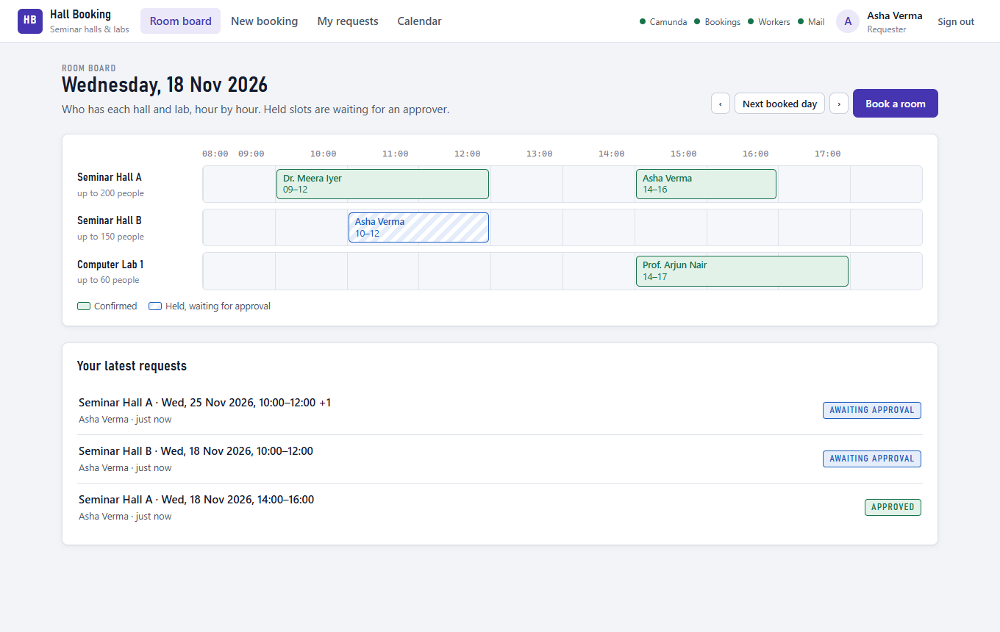

## What it does

- **Sign in with Google.** Anyone with a Google account can book. Listed accounts are also approvers (Admin office,
  Dean, HOD, Lab in-charge) or admins.
- **Book several sessions at once**, for example a two-day workshop in a hall and a lab. The form shows clashes,
  capacity and past dates before you send.
- **Automatic checks.** A job worker validates the request; every session is checked against the booking register in
  parallel; a decision table (DMN) picks the approver for each session.
- **Approval chain.** Each approver is asked in turn and gets **1 day** to decide, with a **reminder after 1 hour**.
  The first rejection stops the chain; an expired review releases the slots.
- **Email updates** to the requester, the approvers and the admins (see [who gets which email](#who-gets-which-email)).
- **Live route** of every request through the processes, and a **service-issue desk** for admins when the booking
  service is down or too slow.

## Screens

**Book a room.** One row per session; the day board on the right shows what is already taken.

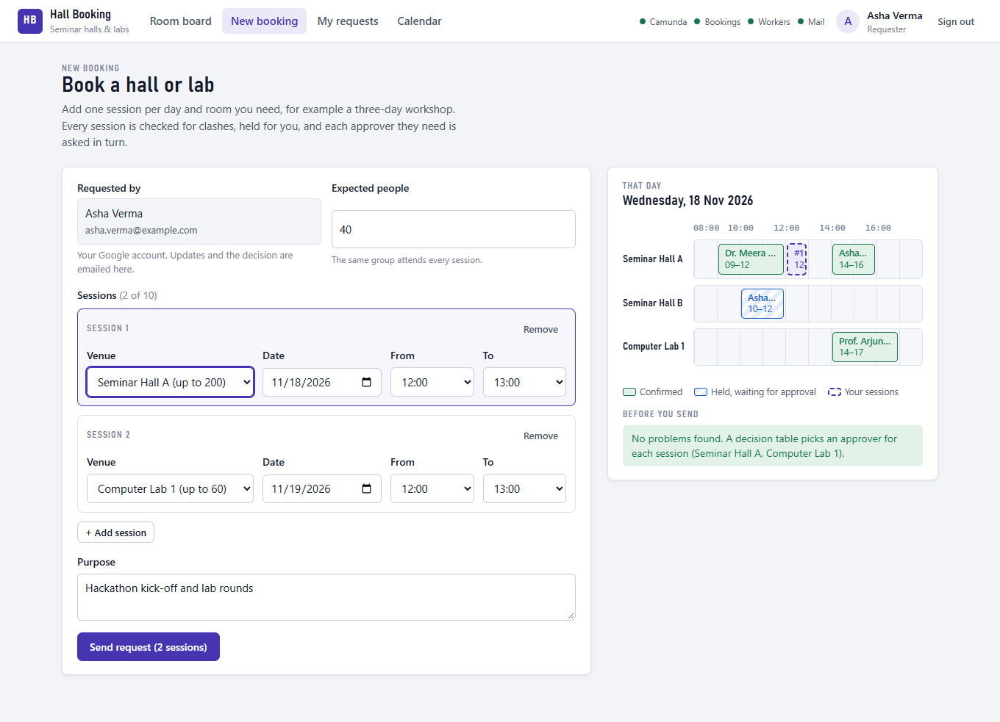

**Follow the request live.** The route shows every step of the booking process (left) and of each approval (right),
including the emails sent. Left: waiting for the first of two approvers. Right: approved and finished.

<p>
  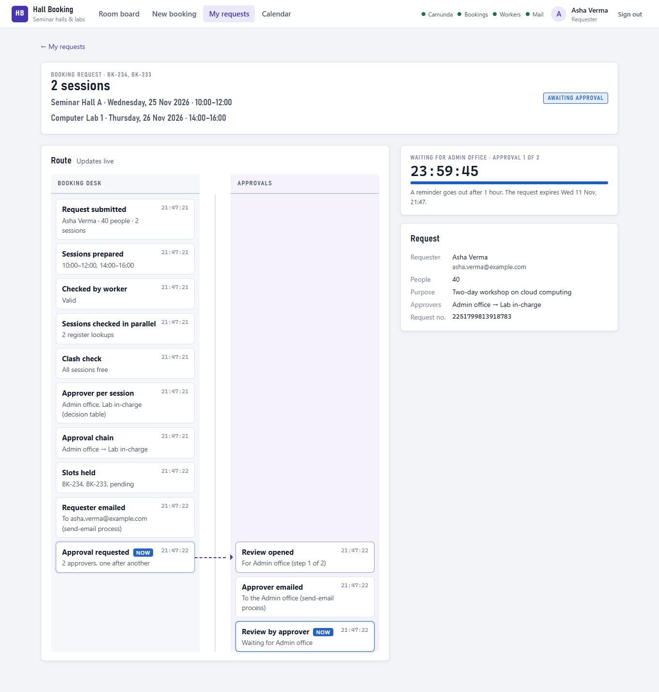
  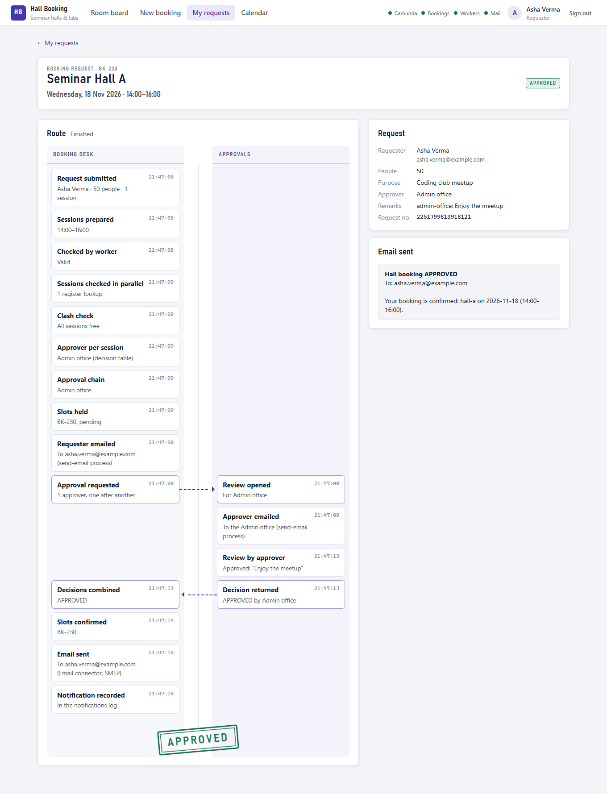
</p>

**Approve or reject.** Approvers see the reviews for their own roles, with the time left before each one expires.

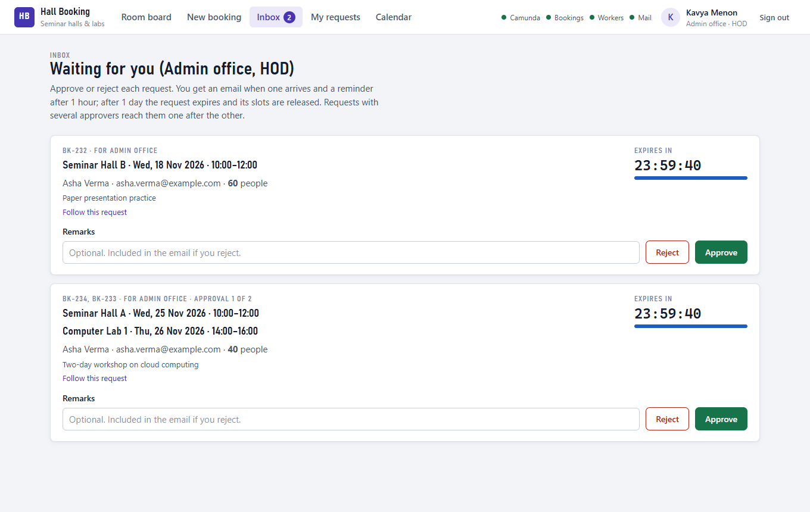

**Emails.** Every step sends an update (here in MailDev, the local test inbox; with Gmail they reach real inboxes).

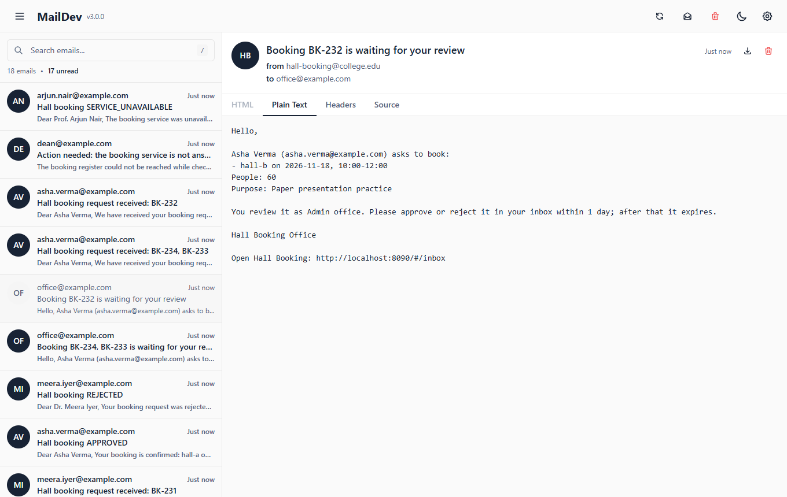

**Service issues.** When the booking register is down or too slow, the request waits here and the admins are emailed;
they retry once it is back, or cancel. The switch on the right simulates an outage for demos.

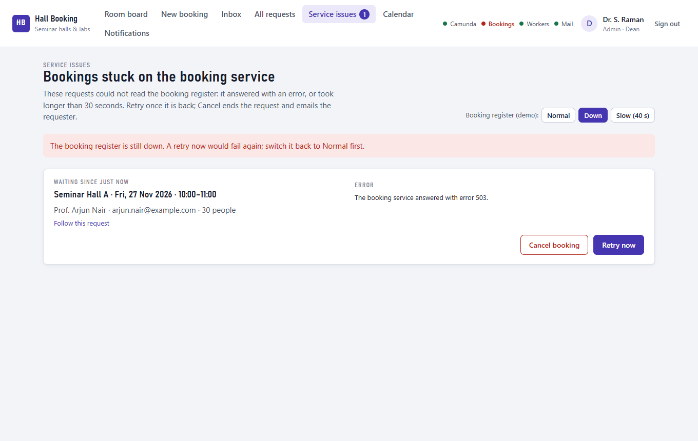

<details>
<summary>More screens: sign-in page, my requests, all requests</summary>

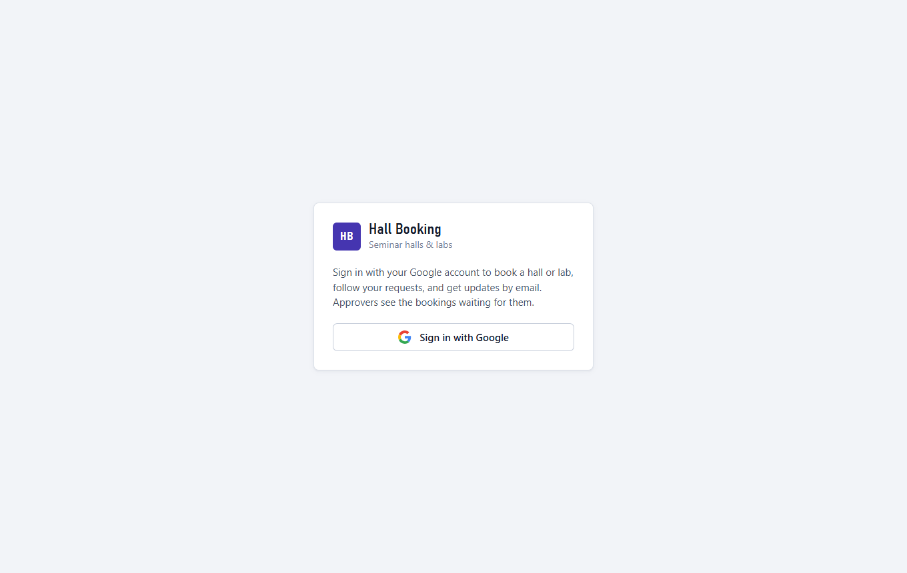

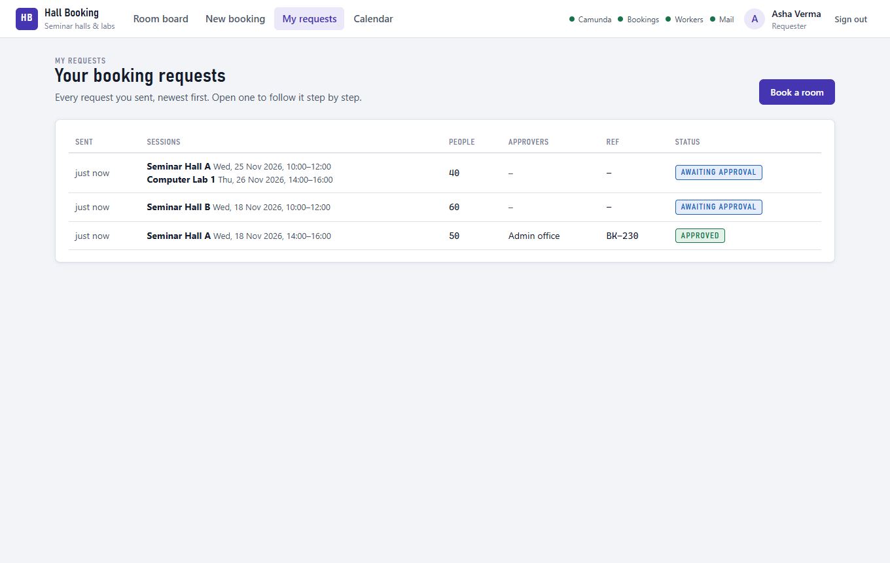

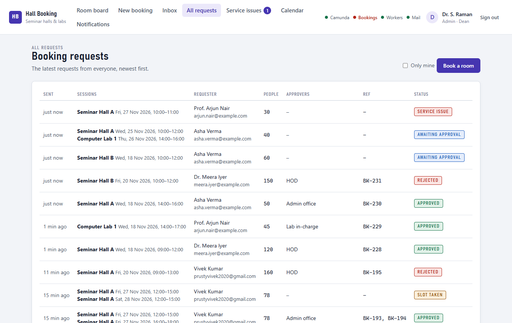

</details>

## How it works

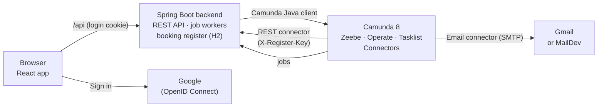

The React app talks only to the backend. The backend starts bookings and completes tasks through the Camunda Java
client, runs the job workers, and is also the **booking register** that Camunda's REST connectors call. Emails go out
through Camunda's **Email connector**; the mail server, its login and all other secrets are connector secrets.

### The processes

**Booking** (`hall-booking`): validate, check every session in parallel inside a sub-process (with an error boundary for
"service down" and a 30-second timer for "too slow"), pick approvers (DMN), hold the slots, email the requester, ask
the approvers one after the other (call activity), then confirm or release the slots and email the decision.

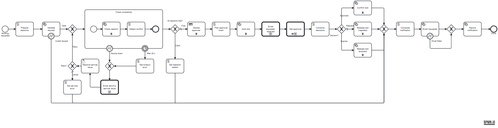

**Approval** (`hall-approval`), called once per approver: email the approver, wait for the review (reminder after
1 hour, expiry after 1 day), record the decision.

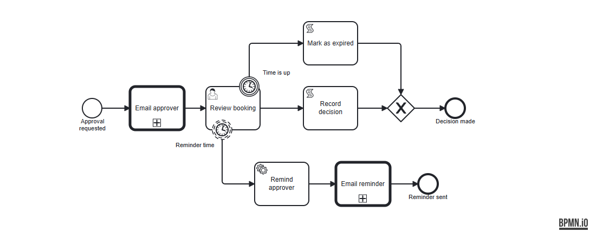

**Send email** (`send-email`), reused by both processes: a job worker finds the recipients (a role becomes the accounts
holding it), then the Email connector sends; a failed email is recorded and never stops a booking.

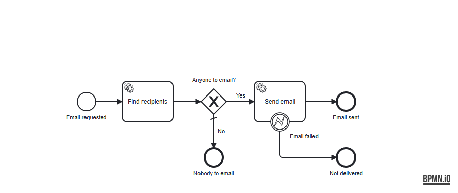

BPMN constructs used: parallel and sequential **multi-instance**, an embedded **sub-process** with **error** and
**timer boundary events**, **call activities** to two reusable child processes, non-interrupting and interrupting
**timers**, **user tasks** with Camunda Forms, a **business rule task** (DMN, hit policy FIRST), **script tasks**
(FEEL), **REST** and **Email** connectors, and **job workers** that throw a BPMN error. The full mapping is in
[hall-booking/README.md](hall-booking/README.md).

## Who gets which email

| When | To | Subject |
|---|---|---|
| The slots are held | The requester | Hall booking request received: BK-… |
| A review opens | The accounts holding that approver role (the admins if nobody does) | Booking BK-… is waiting for your review |
| 1 hour later, still undecided | The same accounts | Reminder: booking BK-… is still waiting for your review |
| The booking service fails | The admins | Action needed: the booking service is not answering |
| The request ends | The requester | Hall booking APPROVED / REJECTED / EXPIRED / CONFLICT / … |

The update emails link to the right page of the app (the inbox, your requests, service issues). If the mail server is
down, the booking still finishes; the email is marked as not delivered on the request page and in the Notifications
log.

## Who can do what

| Account | Can |
|---|---|
| Anyone who signs in (requester) | Book rooms, see their own requests and their live route, see the room board and calendar |
| Approver: Admin office, Dean, HOD, Lab in-charge | The above, plus approve or reject the reviews for their own role(s) |
| Admin | Everything: all requests, every review (deciding only for roles they hold), service issues, the notifications log |

Roles belong to Google accounts and are set in `APP_ACCOUNTS` (one account can hold several, e.g. Dean and Admin).
The backend enforces every rule; the pages only hide what does not apply.

## Quick start (Windows)

**Requirements:** Camunda 8 Run 8.8, JDK 21, Node.js 20.19 or later, and (to edit the models) Camunda Desktop
Modeler 5.

**1. Secrets (once).** Copy `hall-booking\scripts\secrets.example.cmd` to `secrets.cmd` in the same folder (it is
git-ignored) and fill in:

| Setting | What to put |
|---|---|
| `GOOGLE_CLIENT_ID`, `GOOGLE_CLIENT_SECRET` | A Google OAuth client (*Web application*) from [Google Cloud Console](https://console.cloud.google.com): origins `http://localhost:8090` and `http://localhost:5173`, redirect URI `http://localhost:8090/login/oauth2/code/google`. While the app is in *Testing*, add every account that signs in as a test user |
| `APP_ACCOUNTS` | Roles per account: `dean@college.edu=dean+admin;office@college.edu=admin-office+hod;lab@college.edu=lab-incharge` |
| `REGISTER_API_KEY` | Any long random text (the key Camunda's REST connectors send to the booking register) |
| Mail (`SMTP_*`, `MAIL_FROM`) | The local MailDev inbox by default. For real email through Gmail: 2-Step Verification on the sending account, an [App Password](https://myaccount.google.com/apppasswords), then `smtp.gmail.com`, port `587`, `SMTP_SECURITY=TLS` (the Gmail lines are ready in the file) |
| `APPROVAL_TIMEOUT`, `APPROVAL_REMINDER` | Optional: the default is 1 day and 1 hour; `PT2M` and `PT1M` show the reminder and the expiry in a live demo |

**2. Start.** Double-click `hall-booking\scripts\start-all.cmd`, or run the three windows yourself:

```
hall-booking\scripts\start-mail.cmd       :: local mail inbox on http://localhost:1080 (not needed with Gmail)
hall-booking\scripts\start-camunda.cmd    :: Camunda 8 Run, 1-3 minutes (edit the two paths inside for your machine)
hall-booking\scripts\start-backend.cmd    :: backend + React app on http://localhost:8090, deploys the models
```

**3. Use it.** Open **http://localhost:8090** and sign in with Google. The four lights at the top turn green when
Camunda, the booking register, the workers and the mail server are ready. Operate and Tasklist run on
http://localhost:8080 (login `demo` / `demo`). `hall-booking\scripts\reset-data.cmd` restores the three seed bookings.

## Tests

| What | How | Result (10 Nov 2026) |
|---|---|---|
| Backend unit and web tests (security, roles, CSRF, validation, workers) | `backend-springboot\mvnw.cmd test` | 46 passed |
| 25 workflow scenarios: every outcome, the DMN rules, slot holds, multi-session chains, the reminder and expiry, and every email | `powershell -ExecutionPolicy Bypass -File hall-booking\scripts\run-scenarios.ps1` (mail must be MailDev; the script refuses to run with real mail) | 25 of 25 |
| Service down (retry, cancel), service too slow, mail server down | Service issues page and its outage switch; stop MailDev | all passed |
| Sign-in, roles, refused API calls, emails | In a browser, with each kind of account | all passed |

## Project layout

```
hall-booking/            BPMN, DMN and forms; scripts/ to start, deploy, reset and test
  hall-booking.bpmn      main process
  hall-approval.bpmn     child process, once per approver
  send-email.bpmn        child process for the update emails
  decide-approver.dmn    approver per session
backend-springboot/      Spring Boot: REST API, security, job workers, booking register (JPA, H2 or PostgreSQL)
frontend-react/          React + Vite + Tailwind: the web app
docs/images/             the pictures in this file
PLAN.md                  the specification: element IDs, variables, job types, test cases
```

More detail: [hall-booking/README.md](hall-booking/README.md) (demo outline, course requirements),
[backend-springboot/README.md](backend-springboot/README.md) (API, security, database, configuration),
[frontend-react/README.md](frontend-react/README.md) (pages and structure), [PLAN.md](PLAN.md) (specification).
